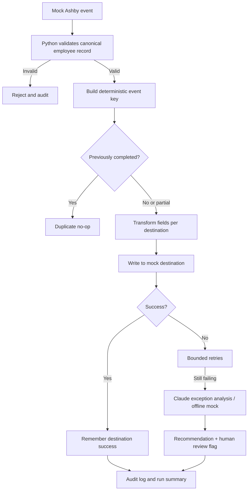

# Employee Change Propagation Engine + Claude Exception Handler

A take-home prototype for the BetterUp People Systems AI Automation Engineer exercise. It demonstrates cross-system employee change propagation using mock connectors, with an optional live Claude API integration for analyzing exhausted destination failures.

## What Claude does — and does not do

Claude is a **meaningful but bounded component**: after Python exhausts its retries for a destination, the exception handler can ask Claude to explain the technical failure and recommend safe next steps. The application requests structured JSON (`issue`, `recommendation`, `requires_human_review`). Only the destination name, attempt count, and technical error are sent; employee names, email addresses, dates, and other employee fields are not sent.

Python remains responsible for schema validation, retry policy, transformations, destination writes, idempotency, and audit logging. Claude cannot approve provisioning or execute a downstream write. If Claude times out or returns invalid data, the original integration failure remains visible and the case is flagged for human review.

Without an API key, the demo uses a clearly labelled `OfflineDemoAnalyzer` so the entire project remains runnable offline. That mock is **not a live Claude call**. Set `ANTHROPIC_API_KEY` to enable the actual Claude Messages API integration. Optionally set `ANTHROPIC_MODEL` to override the default model.

## Mocked systems

- Ashby: represented by sample incoming change events
- Workday
- Okta/Lumos
- Equipment
- Cohort tracker

These are local mock adapters; the project does not connect to actual vendor APIs.

## Architecture



## Requirements and run

- Python 3.10+
- No third-party Python dependencies required

```bash
python main.py
python -m unittest discover -s tests -v
```

### Enable live Claude

1. Obtain an Anthropic API key for an account you are authorized to use.
2. Set it in your shell environment; do not hard-code it or commit it.

Linux/macOS:
```bash
export ANTHROPIC_API_KEY="your-key"
python main.py
```

PowerShell:
```powershell
$env:ANTHROPIC_API_KEY="your-key"
python main.py
```

The demo deliberately triggers one exhausted equipment-connector failure so you can see the exception-analysis component in the output. Live API usage may incur charges. If no key is set, the demo clearly announces offline mock mode.


## Optional MCP integration (local mock environment)

The project includes `mcp_server.py`, an optional Model Context Protocol (MCP) server exposing three tools:

- `process_employee_change(event_json)`: validates and propagates a JSON event to the in-memory mock destinations.
- `get_propagation_status(event_id)`: returns the event's audit-derived outcome and per-destination statuses, without employee PII.
- `list_mock_destinations()`: lists mock destinations and record counts.

This is a real MCP server implementation, but it only operates on local in-memory mock systems; it does not connect to Workday, Okta, or other vendor APIs. Core demo mode still requires no Claude account or API key. MCP server usage requires installing the optional SDK:

```powershell
python -m pip install -r requirements-mcp.txt
python mcp_server.py
```

The server uses MCP's standard input/output (stdio) transport, so launch it from an MCP-compatible client configured to run this command. Keep stdout reserved for the MCP protocol; do not add ordinary `print()` debugging in the server. A client configuration must use the full path to your Python executable and `mcp_server.py`. The server is intended for local demo use only. Before production, add authenticated client access, authorization around write tools, durable event/audit storage, observability, and tests against the chosen MCP client.

Example `event_json` argument for `process_employee_change`:

```json
{
  "event_id": "evt-mcp-2001",
  "employee": {
    "employee_id": "E201",
    "name": "Alex Morgan",
    "email": "alex.morgan@example.com",
    "location": "Bengaluru",
    "start_date": "2026-11-10"
  }
}
```

## Design decisions

- **Mock connectors:** demonstrate orchestration without vendor credentials.
- **Validation before writes:** malformed required fields are rejected before propagation.
- **Per-destination transformations:** each target gets its own schema.
- **Retries:** bounded retries for simulated transient connection errors.
- **Partial retry safety:** successful destinations are remembered so a retry in the same process targets only unfinished destinations.
- **Idempotency:** a deterministic event key combines event ID and canonical payload; completed duplicate events are no-ops.
- **Claude exception handler:** explains exhausted failures, proposes safe diagnostics, and asks for human review. It does not perform writes or override policy.
- **Audit log:** records attempts, outcomes, and which analyzer provided the exception recommendation.

## Production hardening

The prototype's state and audit log are in memory and reset on restart. Before production, persist event state, destination-level completion, and audit records in a durable database; use real authenticated connector clients; add exponential backoff/jitter, rate-limit handling, dead-letter queues, alerting, schema/version management, PII controls, least privilege, prompt-injection defenses for untrusted error text, API cost/timeout budgets, and integration/contract tests. Define system-of-record ownership and conflict rules before enabling bidirectional updates.

## Why change propagation and why this stack

Change propagation was selected because one employee lifecycle event can affect HR, identity/access, equipment logistics, and onboarding tracking. It demonstrates the end-to-end control points in one runnable slice. Cross-system validation was deprioritized because it mainly detects drift; exception monitoring was deprioritized because it mainly detects/explains failures after they occur. The prototype makes a qualitative leverage argument; it does not claim measured ROI.

Python was chosen to keep validation, per-destination mapping, retry behavior, idempotency, audit logging, tests, and MCP exposure explicit and reproducible. n8n/Zapier may be a better fit for simpler connector-first flows. The choice should be revisited against existing integrations, governance, and operational support before production.

## Source-of-truth and stack alignment

The mock incoming event represents Ashby. The four implemented mock destinations are Workday, Okta/Lumos, Equipment, and Cohort Tracker. Workspace, Slack, and Highspot are listed as potential destinations only where the real employee lifecycle requires them; they are not implemented. The build note contains a field-ownership map and illustrative failure modes. Confirm the authoritative source for each field with system owners before a live integration; this prototype does not establish production ownership policy.

Example transformation: canonical `email="Alex.Morgan@example.com"` becomes Okta/Lumos `username="alex.morgan@example.com"`; Workday maps `employee_id` to `worker_id` and `start_date` to `hire_date`. These are mock payload schemas, not claims about actual vendor API contracts.

## Retry and idempotency specifics

The engine is configured for **3 total attempts per destination**. Retries currently happen immediately, without backoff; exponential backoff with jitter is a production hardening item. The duplicate-event unit test confirms that processing the same completed event again does not increase mock destination write counts. Event and audit state are in memory and reset on restart.

## AI tools and manual correction

ChatGPT and VS Code Agentic Chat were used as development assistants for design guidance, troubleshooting, implementation assistance, and documentation. During MCP setup, an AI-assisted SDK/import recommendation was incompatible with the installed MCP SDK, producing `ModuleNotFoundError` for `mcp.server.fastmcp`. The compatibility issue was corrected by installing the MCP SDK v1 range (`mcp[cli]>=1.0.0,<2.0.0`), then verifying server syntax and three-tool discovery. This is separate from the validation run, which did not reveal a validation mistake.

Do not claim a live Claude API call unless you ran it with a valid key. The offline demo uses `OfflineDemoAnalyzer`; it is not a live Claude call. See `build_note.md` for the full AI-use disclosure, system map, and production limitations.

## Verification evidence

Captured demo and test output is stored under `evidence/`. Re-run `python main.py`, `python -m unittest discover -s tests -v`, and `python -m py_compile mcp_server.py` before submission if you change the code. These runs use local mock destinations and do not verify live vendor integrations.
